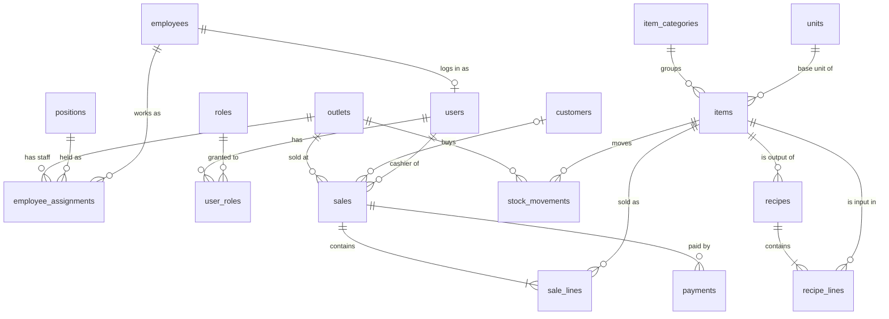

# Database migrations: reference

Describes every file in `migrations/` as of version **00021**.
Database: PostgreSQL 16. Migration tool: [goose](https://github.com/pressly/goose).
Update this document whenever you add a migration.

## Conventions

- **File format:** one file per change, `NNNNN_name.sql`, with a `-- +goose Up` and a `-- +goose Down` section. goose runs each file in its own transaction.
- **Primary keys:** `id bigint GENERATED ALWAYS AS IDENTITY` (the database assigns it; the app cannot insert its own value).
- **Text:** `text` everywhere; no `varchar(n)` length limits.
- **Money:** `numeric(18,2)`. Quantities: `numeric(18,4)`. Tax rates: `numeric(7,4)`, where `0.1100` = 11%.
- **Time:** `timestamptz`, defaulting to `now()`. Plain dates use `date`.
- **Enumerations:** stored as `text` with a `CHECK (... IN (...))` list.
- **Schema names:** always written out, e.g. `org.outlets`, `REFERENCES org.outlets(id)`.
- **Applied versions:** recorded by goose in `public.goose_db_version`.
- **No business logic in the database.** No calculations, triggers, functions or cascading deletes (`ON DELETE CASCADE`): a row that other rows still reference cannot be deleted. Totals, tax, stock on hand, the append-only ledger rule and permission checks all live in the Go backend. The database only enforces the shape of the data: `NOT NULL`, foreign keys, `UNIQUE`, enum and simple single-column `CHECK`s (e.g. `>= 0`), and the exclusion constraints in 00008, which stop overlaps that two concurrent requests could otherwise both create.
- **Indexes:** PostgreSQL does not index foreign-key columns by itself. Each table's migration creates the indexes it needs.
- **Database user:** one user (`POSTGRES_USER`) for migrations and the backend, for now.

## Schemas

| Schema | Purpose | Objects |
|---|---|---|
| `org` | Company structure: outlets, jobs, people | outlets, positions, employees, employee_assignments, view employee_current_assignment |
| `auth` | Login and permissions | roles, users, user_roles |
| `inventory` | What is stocked, how it is made, how it moves | units, item_categories, suppliers, items, recipes, recipe_lines, stock_movements |
| `sales` | POS and customers | tax_rates, customers, sales, sale_lines, payments |
| `public` | PostgreSQL default | extension btree_gist, goose_db_version |

## Migration list

| Version | File | Schema | Creates | Depends on |
|---|---|---|---|---|
| 00001 | `00001_enable_btree_gist.sql` | public | extension `btree_gist` | none |
| 00002 | `00002_create_schemas.sql` | none | schemas `org`, `auth`, `inventory`, `sales` | none |
| 00003 | `00003_create_outlets.sql` | org | `outlets` | 00002 |
| 00004 | `00004_create_positions.sql` | org | `positions` | 00002 |
| 00005 | `00005_create_employees.sql` | org | `employees` | 00002 |
| 00006 | `00006_create_roles.sql` | auth | `roles` | 00002 |
| 00007 | `00007_create_users.sql` | auth | `users` | 00005 |
| 00008 | `00008_create_employee_assignments.sql` | org | `employee_assignments`, view `employee_current_assignment` | 00001, 00003, 00004, 00005, 00007 |
| 00009 | `00009_create_tax_rates.sql` | sales | `tax_rates` | 00002 |
| 00010 | `00010_create_units.sql` | inventory | `units` | 00002 |
| 00011 | `00011_create_item_categories.sql` | inventory | `item_categories` | 00002 |
| 00012 | `00012_create_suppliers.sql` | inventory | `suppliers` | 00002 |
| 00013 | `00013_create_items.sql` | inventory | `items` | 00010, 00011 |
| 00014 | `00014_create_recipes.sql` | inventory | `recipes` | 00013 |
| 00015 | `00015_create_recipe_lines.sql` | inventory | `recipe_lines` | 00013, 00014 |
| 00016 | `00016_create_stock_movements.sql` | inventory | `stock_movements` | 00003, 00007, 00013 |
| 00017 | `00017_create_customers.sql` | sales | `customers` | 00002 |
| 00018 | `00018_create_sales.sql` | sales | `sales` | 00003, 00007, 00017 |
| 00019 | `00019_create_sale_lines.sql` | sales | `sale_lines` | 00013, 00018 |
| 00020 | `00020_create_payments.sql` | sales | `payments` | 00018 |
| 00021 | `00021_create_user_roles.sql` | auth | `user_roles` | 00006, 00007 |

`goose down` reverses them in the opposite order. Every Down step drops only what its Up step created.

## Relationships



Not drawn, to keep the diagram readable: `created_by` / `granted_by` columns pointing to `auth.users`, and `suppliers` and `tax_rates`, which have no foreign keys yet (`items.tax_rate_code` matches `tax_rates.code` by value).

---

## 00001 · Extension `btree_gist`

Lets a GiST exclusion constraint combine `=` on a `bigint` column with `&&` (overlap) on a date range. Used by both exclusion constraints in `org.employee_assignments`. Ships with PostgreSQL and is installed in `public`.

Down: `DROP EXTENSION IF EXISTS btree_gist`.

## 00002 · Schemas

Creates `org`, `auth`, `inventory`, `sales`. Down drops them **without** `CASCADE`, so it fails if any table is still inside instead of deleting data.

## 00003 · `org.outlets`

Bakery branches.

| Column | Type | Rules |
|---|---|---|
| id | bigint | PK, identity |
| code | text | required, unique |
| name | text | required |
| address | text | |
| is_active | boolean | required, default `true` |
| created_at | timestamptz | required, default `now()` |
| updated_at | timestamptz | required, default `now()` |

## 00004 · `org.positions`

Job titles (HR side), e.g. `baker`, `cashier`, `store_manager`. Separate from software roles.

| Column | Type | Rules |
|---|---|---|
| id | bigint | PK, identity |
| code | text | required, unique |
| name | text | required |
| is_active | boolean | required, default `true` |

## 00005 · `org.employees`

People employed by the bakery. Current job and outlet are **not** stored here; see `employee_assignments`. Sensitive payroll data (NIK, NPWP, bank account, BPJS) is planned for a separate table in the payroll phase.

| Column | Type | Rules |
|---|---|---|
| id | bigint | PK, identity |
| employee_no | text | required, unique |
| full_name | text | required |
| phone | text | |
| email | text | |
| employment_type | text | required, default `permanent`; one of `permanent`, `contract`, `daily`, `part_time` |
| hire_date | date | required |
| end_date | date | |
| is_active | boolean | required, default `true` |
| created_at | timestamptz | required, default `now()` |
| updated_at | timestamptz | required, default `now()` |

## 00006 · `auth.roles`

Software permission roles, e.g. `owner`, `manager`, `cashier`, `baker`, `accountant`.

| Column | Type | Rules |
|---|---|---|
| id | bigint | PK, identity |
| code | text | required, unique |
| name | text | required |

## 00007 · `auth.users`

Logins. One login per employee. Roles are in `auth.user_roles` (00021).

| Column | Type | Rules |
|---|---|---|
| id | bigint | PK, identity |
| employee_id | bigint | required, **unique**, FK → `org.employees(id)` |
| username | text | required, unique |
| password_hash | text | required (store a hash such as bcrypt/argon2, never the password) |
| is_active | boolean | required, default `true` |
| last_login_at | timestamptz | |
| created_at | timestamptz | required, default `now()` |

## 00008 · `org.employee_assignments` + view `org.employee_current_assignment`

One row per period an employee held a position at an outlet. Period is half-open `[valid_from, valid_to)`; `valid_to` NULL means current. An employee may hold **several jobs at once** (e.g. baker + store manager) and the same job at several outlets.

| Column | Type | Rules |
|---|---|---|
| id | bigint | PK, identity |
| employee_id | bigint | required, FK → `org.employees(id)` |
| outlet_id | bigint | required, FK → `org.outlets(id)` |
| position_id | bigint | required, FK → `org.positions(id)` |
| is_primary | boolean | required, default `false`; the main job for payroll and reports |
| valid_from | date | required |
| valid_to | date | must be after `valid_from` if set |
| change_reason | text | required; one of `hire`, `promotion`, `demotion`, `transfer`, `position_change`, `additional`, `other` |
| note | text | |
| created_by | bigint | FK → `auth.users(id)` |
| created_at | timestamptz | required, default `now()` |

Rules enforced by the database:
- **Same job can't overlap itself:** exclusion on (employee, outlet, position, period).
- **At most one primary job at a time:** exclusion on (employee, period) `WHERE is_primary`.
- **Not enforced:** that a current employee has *at least* one primary job. The application must set one on hire.

Index: `idx_assignments_outlet (outlet_id, valid_from)`.

View `employee_current_assignment`: `employee_id, outlet_id, position_id, is_primary, valid_from` for every job held today. One row per job.

Down drops the view, then the table.

## 00009 · `sales.tax_rates`

Tax rates with validity periods, so a rate change doesn't alter old sales.

| Column | Type | Rules |
|---|---|---|
| id | bigint | PK, identity |
| code | text | required, e.g. `VAT` |
| name | text | required |
| rate | numeric(7,4) | required, ≥ 0; `0.1100` = 11% |
| effective_from | date | required |
| effective_to | date | ≥ `effective_from` if set |

Unique: `(code, effective_from)`.

## 00010 · `inventory.units`

Units of measure and their conversion to a base unit per dimension.

| Column | Type | Rules |
|---|---|---|
| id | bigint | PK, identity |
| code | text | required, unique; e.g. `g`, `kg`, `ml`, `l`, `pcs` |
| name | text | required |
| dimension | text | required; one of `mass`, `volume`, `count` |
| to_base | numeric(18,6) | required, > 0; e.g. g = 1, kg = 1000 |

## 00011 · `inventory.item_categories`

| Column | Type | Rules |
|---|---|---|
| id | bigint | PK, identity |
| name | text | required, unique |

## 00012 · `inventory.suppliers`

May move to a `purchasing` schema in the purchasing phase.

| Column | Type | Rules |
|---|---|---|
| id | bigint | PK, identity |
| name | text | required |
| phone | text | |
| email | text | |
| address | text | |
| is_active | boolean | required, default `true` |

## 00013 · `inventory.items`

Everything stocked or sold: raw materials, semi-finished goods, finished goods, packaging.

| Column | Type | Rules |
|---|---|---|
| id | bigint | PK, identity |
| sku | text | required, unique |
| name | text | required |
| item_type | text | required; one of `raw_material`, `semi_finished`, `finished_good`, `packaging` |
| category_id | bigint | FK → `inventory.item_categories(id)` |
| base_unit_id | bigint | required, FK → `inventory.units(id)`; all stock is counted in this unit |
| is_sellable | boolean | required, default `false` |
| selling_price | numeric(18,2) | ≥ 0; **required when `is_sellable`** |
| tax_rate_code | text | matched to `sales.tax_rates.code` at sale time |
| shelf_life_days | integer | |
| reorder_level | numeric(18,4) | |
| is_active | boolean | required, default `true` |
| created_at | timestamptz | required, default `now()` |
| updated_at | timestamptz | required, default `now()` |

Index: `idx_items_type (item_type) WHERE is_active`.

## 00014 · `inventory.recipes`

Bill of materials header. Versioned per output item.

| Column | Type | Rules |
|---|---|---|
| id | bigint | PK, identity |
| output_item_id | bigint | required, FK → `inventory.items(id)` |
| version | integer | required, default `1` |
| yield_qty | numeric(18,4) | required, > 0; output per batch in the output item's base unit |
| notes | text | |
| is_active | boolean | required, default `true` |
| created_at | timestamptz | required, default `now()` |

Unique: `(output_item_id, version)`.

## 00015 · `inventory.recipe_lines`

Ingredients of a recipe.

| Column | Type | Rules |
|---|---|---|
| id | bigint | PK, identity |
| recipe_id | bigint | required, FK → `inventory.recipes(id)`; a recipe with lines can't be deleted |
| input_item_id | bigint | required, FK → `inventory.items(id)` |
| qty | numeric(18,4) | required, > 0; per batch, in the input item's base unit |

Unique: `(recipe_id, input_item_id)`. Index: `idx_recipe_lines_input (input_item_id)`.

## 00016 · `inventory.stock_movements`

Append-only stock ledger. **Never UPDATE or DELETE rows**; corrections are new rows. The backend enforces this (its stock repository only inserts); there is no database trigger.

| Column | Type | Rules |
|---|---|---|
| id | bigint | PK, identity |
| outlet_id | bigint | required, FK → `org.outlets(id)` |
| item_id | bigint | required, FK → `inventory.items(id)` |
| movement_type | text | required; one of `purchase`, `production_in`, `production_out`, `sale`, `waste`, `adjustment`, `transfer_in`, `transfer_out` |
| qty_change | numeric(18,4) | required, ≠ 0; signed, in base unit |
| unit_cost | numeric(18,4) | cost per base unit, if known |
| expiry_date | date | |
| reference_type | text | e.g. `sale`, `purchase_order` |
| reference_id | bigint | id in the referenced table (not a foreign key) |
| note | text | |
| created_by | bigint | FK → `auth.users(id)` |
| created_at | timestamptz | required, default `now()` |

Indexes: `idx_stock_mov_lookup (outlet_id, item_id, created_at)`, `idx_stock_mov_ref (reference_type, reference_id)`.

Stock on hand is calculated by the backend, with `sum(qty_change)` grouped by outlet and item (query in the migration's comment). There is no view.

## 00017 · `sales.customers`

| Column | Type | Rules |
|---|---|---|
| id | bigint | PK, identity |
| name | text | required |
| phone | text | unique |
| email | text | |
| birth_date | date | |
| loyalty_points | integer | required, default `0`, ≥ 0 |
| notes | text | |
| created_at | timestamptz | required, default `now()` |
| updated_at | timestamptz | required, default `now()` |

## 00018 · `sales.sales`

Sale header (one receipt).

| Column | Type | Rules |
|---|---|---|
| id | bigint | PK, identity |
| client_uuid | uuid | required, unique; generated by the POS device so offline sync can't create duplicates |
| outlet_id | bigint | required, FK → `org.outlets(id)` |
| receipt_no | text | required |
| customer_id | bigint | FK → `sales.customers(id)`; NULL for walk-in customers |
| cashier_id | bigint | required, FK → `auth.users(id)` |
| status | text | required, default `completed`; one of `open`, `completed`, `void`, `refunded` |
| subtotal | numeric(18,2) | required, ≥ 0 |
| discount_total | numeric(18,2) | required, default `0`, ≥ 0 |
| tax_total | numeric(18,2) | required, default `0`, ≥ 0 |
| grand_total | numeric(18,2) | required, ≥ 0 |
| sold_at | timestamptz | required; device time of sale |
| synced_at | timestamptz | required, default `now()`; server receive time |

Unique: `(outlet_id, receipt_no)`. Indexes: `idx_sales_outlet_date (outlet_id, sold_at)`, `idx_sales_customer (customer_id)` for rows with a customer.

The backend calculates all totals (subtotal, discount, tax, grand total, rounding) and checks that they match the lines and that payments cover the grand total. The database does not recalculate or cross-check them.

## 00019 · `sales.sale_lines`

Items on a receipt. Price and tax are snapshots, so later price changes don't rewrite history.

| Column | Type | Rules |
|---|---|---|
| id | bigint | PK, identity |
| sale_id | bigint | required, FK → `sales.sales(id)`; a sale with lines can't be deleted |
| item_id | bigint | required, FK → `inventory.items(id)` |
| qty | numeric(18,4) | required, > 0 |
| unit_price | numeric(18,2) | required, ≥ 0 |
| discount | numeric(18,2) | required, default `0`, ≥ 0 |
| tax_rate | numeric(7,4) | required, default `0`, ≥ 0 |
| tax_amount | numeric(18,2) | required, default `0`, ≥ 0 |
| line_total | numeric(18,2) | required, ≥ 0 |

Indexes: `idx_sale_lines_sale (sale_id)`, `idx_sale_lines_item (item_id)`. Cancel a sale with `sales.status` (`void`, `refunded`); don't delete it.

## 00020 · `sales.payments`

Payments for a sale. A sale can have several (e.g. part cash, part QRIS).

| Column | Type | Rules |
|---|---|---|
| id | bigint | PK, identity |
| sale_id | bigint | required, FK → `sales.sales(id)`; a sale with payments can't be deleted |
| method | text | required; one of `cash`, `card`, `qris`, `ewallet`, `transfer` |
| amount | numeric(18,2) | required, > 0 |
| reference | text | gateway or terminal reference |
| paid_at | timestamptz | required, default `now()` |

Index: `idx_payments_sale (sale_id)`.

## 00021 · `auth.user_roles`

Which roles each user holds. Permissions are the combination of all of a user's roles. Roles apply to all outlets.

| Column | Type | Rules |
|---|---|---|
| user_id | bigint | required, FK → `auth.users(id)`; a user with roles can't be deleted |
| role_id | bigint | required, FK → `auth.roles(id)` |
| granted_by | bigint | FK → `auth.users(id)` |
| granted_at | timestamptz | required, default `now()` |

Primary key: `(user_id, role_id)`. Index: `idx_user_roles_role (role_id)`.

---

## Running

From `bakery-golang`, with Postgres running. goose reads `GOOSE_DRIVER`, `GOOSE_DBSTRING` and `GOOSE_MIGRATION_DIR` from `bakery-golang/.env` (not committed; create it once with `copy .env.example .env`).

```cmd
goose env
goose status
goose up
goose down
```
